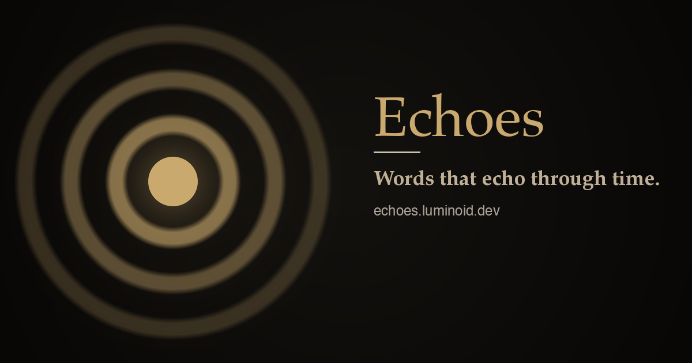

# Echoes

[](LICENSE)
[](https://svelte.dev/docs/kit)

A curated collection of timeless quotes from philosophers, writers, artists, scientists, and more, in English and Chinese. 2,300+ quotes across 18 categories, each attributed to its author on a dedicated page.

**Live**: [echoes.luminoid.dev](https://echoes.luminoid.dev) (EN) · [echoes.luminoid.dev/zh/](https://echoes.luminoid.dev/zh/) (中文)

<p align="center">
  <a href="https://echoes.luminoid.dev"></a>
</p>

Built with SvelteKit 3, Svelte 5, Tailwind CSS 4, and Vite 8. Deployed as a static site to Cloudflare Pages.

## Features

- 2,300+ quotes across 18 categories: philosophers, writers, poets, playwrights, essayists, scientists, psychologists, historians, economists, artists, architects, photographers, designers, musicians, filmmakers, cinema, comedians, activists
- Bilingual: English and Chinese (Simplified), with per-locale alphabetical sorting
- Search across people and quotes
- Light/dark theme with OS preference detection
- Randomized featured quotes on each visit; chronological quote ordering on person pages
- Fully static: prerendered at build time, no runtime server
- SEO: Open Graph, Twitter Cards, hreflang alternates, canonical URLs, JSON-LD on person pages, `sitemap.xml` + `robots.txt`
- Accessible: focus indicators, ARIA labels, keyboard navigation, screen reader support

## Development

```bash
npm install
npm run dev
```

## Build

```bash
npm run build
npm run preview
```

## Project Structure

```
src/
  lib/
    components/   # Svelte components (Header, Footer, PersonCard, QuoteBlock, etc.)
    data/         # Quote data by category (18 files) + types + index
    i18n/         # Translation strings (EN/ZH)
  routes/         # SvelteKit pages (home, category, person detail, search) + sitemap.xml
static/           # Favicon, OG image, robots.txt, _headers
```

## License

[CC BY-NC-SA 4.0](LICENSE). The quotes themselves belong to their authors and are reproduced under fair use for commentary and education; the license covers this curated selection, its translations, and the site.
